  <picture>
    <source media="(prefers-color-scheme: dark)" srcset="assets/hero-dark.svg">
    
  </picture>

  <picture>
    <source media="(prefers-color-scheme: dark)" srcset="assets/repos-dark.svg">
    
  </picture>

  <a href="https://github.com/islan-max/caderno-de-estudos">caderno</a> ·
  <a href="https://github.com/islan-max/trevo">diário de gastos</a> ·
  <a href="https://github.com/Origenes-System-Develop/polar">polar</a> ·
  <a href="https://github.com/islan-max/farol">farol</a> ·
  <a href="https://github.com/islan-max/encaixe">encaixe</a>

  <picture>
    <source media="(prefers-color-scheme: dark)" srcset="assets/grafico-dark.svg">
    
  </picture>

  <picture>
    <source media="(prefers-color-scheme: dark)" srcset="assets/numeros-dark.svg">
    
  </picture>

As imagens são geradas por <a href="scripts/build.mjs">scripts/build.mjs</a> todo dia, a partir dos dados públicos do perfil (contribuições privadas entram só como número).

