  <picture>
    <source media="(prefers-color-scheme: dark)" srcset="assets/hero-dark.svg">
    
  </picture>

  <picture><source media="(prefers-color-scheme: dark)" srcset="assets/projetos-dark.svg"></picture> 
  <a href="https://github.com/islan-max/caderno-de-estudos"><picture><source media="(prefers-color-scheme: dark)" srcset="assets/caderno-dark.svg"></picture></a><a href="https://github.com/islan-max/trevo"><picture><source media="(prefers-color-scheme: dark)" srcset="assets/gastos-dark.svg"></picture></a> 
  <a href="https://github.com/Origenes-System-Develop/polar"><picture><source media="(prefers-color-scheme: dark)" srcset="assets/polar-dark.svg"></picture></a><a href="https://github.com/islan-max/farol"><picture><source media="(prefers-color-scheme: dark)" srcset="assets/farol-dark.svg"></picture></a><a href="https://github.com/islan-max/encaixe"><picture><source media="(prefers-color-scheme: dark)" srcset="assets/encaixe-dark.svg"></picture></a>

  <picture>
    <source media="(prefers-color-scheme: dark)" srcset="assets/grafico-dark.svg">
    
  </picture>

  <picture>
    <source media="(prefers-color-scheme: dark)" srcset="assets/numeros-dark.svg">
    
  </picture>

