

  <picture>
    <source media="(prefers-color-scheme: dark)" srcset="assets/banner-dark.svg">
    
  </picture>

  <b>Islan Max</b> · Systems Development student · Brazil 
  Every project is a dish. Every commit is a crumb on the counter.

## Counter

The snake eats my contributions, crumb by crumb.

  <picture>
    <source media="(prefers-color-scheme: dark)" srcset="assets/snake-dark.svg">
    
  </picture>

## Menu

My current hand. Each project card opens its repository.

  <picture><source media="(prefers-color-scheme: dark)" srcset="assets/card-islan-dark.svg">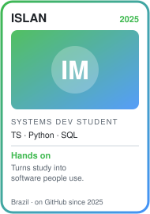</picture>
  <a href="https://github.com/Origenes-System-Develop/polar"><picture><source media="(prefers-color-scheme: dark)" srcset="assets/card-polar-dark.svg">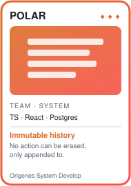</picture></a>
  <a href="https://github.com/islan-max/caderno-de-estudos"><picture><source media="(prefers-color-scheme: dark)" srcset="assets/card-caderno-dark.svg">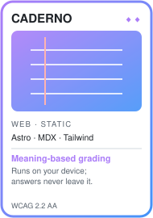</picture></a>
  <a href="https://github.com/islan-max/trevo"><picture><source media="(prefers-color-scheme: dark)" srcset="assets/card-trevo-dark.svg">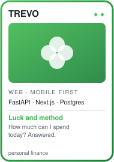</picture></a>
  <picture><source media="(prefers-color-scheme: dark)" srcset="assets/card-soon-dark.svg"></picture>

| Dish | What it is | Taste it |
|---|---|---|
| **POLAR** | School incident management, from the teacher's report to the principal's closing, with an immutable and auditable history. Built with a team. | [live system](https://polarescolar.vercel.app/login) · [code](https://github.com/Origenes-System-Develop/polar) |
| **Caderno de Estudos** | A static library of lessons with spaced review and answer grading that runs on your own device. Accessible (WCAG 2.2 AA). | [live site](https://islan-max.github.io/caderno-de-estudos/) · [code](https://github.com/islan-max/caderno-de-estudos) |
| **Trevo** | Mobile-first personal finance: "how much can I spend today", goals, budgets and installments. | [live site](https://islan-max.github.io/trevo/) · [code](https://github.com/islan-max/trevo) |

## Kitchen dashboard

Same numbers as my contribution graph, rebuilt every day by a GitHub Action.

  <picture><source media="(prefers-color-scheme: dark)" srcset="assets/dash/profile-dark.svg">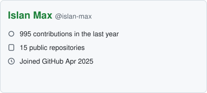</picture>
  <picture><source media="(prefers-color-scheme: dark)" srcset="assets/dash/activity-dark.svg">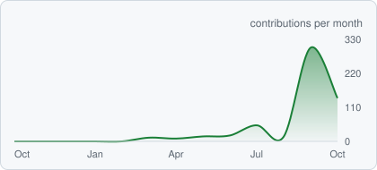</picture>

  <picture><source media="(prefers-color-scheme: dark)" srcset="assets/dash/stats-dark.svg">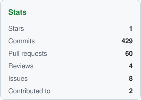</picture>
  <picture><source media="(prefers-color-scheme: dark)" srcset="assets/dash/langs-commit-dark.svg">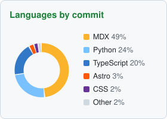</picture>
  <picture><source media="(prefers-color-scheme: dark)" srcset="assets/dash/langs-repo-dark.svg">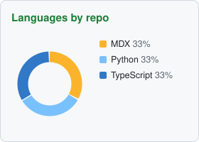</picture>

  <picture><source media="(prefers-color-scheme: dark)" srcset="assets/dash/streak-total-dark.svg">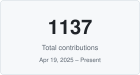</picture>
  <picture><source media="(prefers-color-scheme: dark)" srcset="assets/dash/streak-current-dark.svg">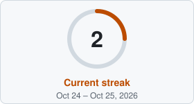</picture>
  <picture><source media="(prefers-color-scheme: dark)" srcset="assets/dash/streak-longest-dark.svg">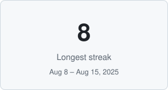</picture>

## On the stove

Studying Systems Development (front-end, back-end, databases, AI, mobile and version control) and turning each subject into something that runs. My study notes live in [Caderno de Estudos](https://github.com/islan-max/caderno-de-estudos).

## Pantry

**Front** `React` `Next.js` `Astro` `Tailwind CSS` `TypeScript` 
**Back** `Express` `FastAPI` `Python` 
**Data** `PostgreSQL` 
**AI** `in-browser embeddings`

## Reservations

No public contact yet. For now, open an issue on any repository above.

The dashboard and the snake are generated by <a href="scripts/build.mjs"><code>scripts/build.mjs</code></a> and <a href="https://github.com/Platane/snk">snk</a> through <a href=".github/workflows/profile.yml">a daily workflow</a>.
